# Facebook-Posting einrichten – Anleitung

Damit der Telegram-Bot mit dem Knopf **📘 Posto + FB** auf die Facebook-Seite posten kann,
braucht er zwei Werte in der `.env` auf dem Server:

```
FB_PAGE_ID=...
FB_PAGE_TOKEN=...
```

Diese Anleitung zeigt Schritt für Schritt, wie man die beiden Werte bekommt.
Am 20.10.2026 hat das so für **Urapress.ch** funktioniert. Für eine andere Seite (z. B. Ride2Balkan) geht es genau gleich.

> **Tokens nie in einen Chat, nie ins Repo, nie in einen Screenshot.**
> Sie gehören nur in die `.env` auf dem Server.

---

## Übersicht

| Schritt | Wo | Ergebnis |
|---|---|---|
| 1 | facebook.com | Eine **Facebook-Seite** (kein Profil!) |
| 2 | developers.facebook.com | Eine **Meta-App** mit dem Anwendungsfall „Seite verwalten" |
| 3 | App → Anwendungsfälle → Anpassen | **3 Berechtigungen** freigeschaltet |
| 4 | Graph API Explorer | **Nutzer-Token** (kurz, ~1 Stunde) |
| 5 | Zugriffsschlüssel-Tool | **Verlängerter Nutzer-Token** (~60 Tage) |
| 6 | Graph API Explorer | **Seiten-ID** + **Seiten-Token** (läuft nicht ab) |
| 7 | Server | Werte in `.env`, Bot neu starten |

Es gibt **drei verschiedene Tokens**. Nur der letzte kommt in die `.env`:

| Token | Gültig | Wofür |
|---|---|---|
| Nutzer-Token | ~1 Stunde | nur Zwischenschritt |
| Verlängerter Nutzer-Token | ~60 Tage | nur Zwischenschritt |
| **Seiten-Token** | **läuft nicht ab** | ✅ **kommt in `FB_PAGE_TOKEN`** |

---

## Schritt 1 – Facebook-Seite (nicht Profil)

Über die API kann man **nur auf eine Seite** posten, nicht auf ein persönliches Profil.

- **Seite:** Links steht „Seite verwalten", dazu gibt es Business-Dashboard, Insights usw.
- **Profil:** Die Adresse sieht aus wie `facebook.com/people/...` oder `profile.php?id=...`. Damit geht es **nicht**.

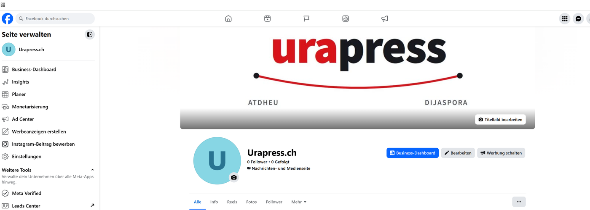

Eine neue Seite legst du an unter: facebook.com/pages/create (Kategorie z. B. „Nachrichten- und Medienwebsite").
Du musst **Admin** der Seite sein.

---

## Schritt 2 – Meta-App erstellen

1. **developers.facebook.com** → oben **Meine Apps** → **App erstellen**
2. App-Name eingeben (z. B. `urapress`), weiter.

### Anwendungsfall wählen

Links den Filter **„Content-Management"** anklicken. Dann **nur** den Anwendungsfall
**„Alles auf deiner Seite verwalten"** ankreuzen (Fähnchen-Symbol, „Infos zur Pages API"). Danach **Weiter**.

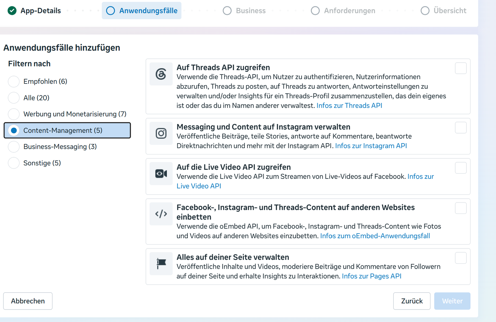

### Business-Portfolio

Das eigene Portfolio (hier „Qani Tufekcis Unternehmen") ausgewählt lassen und auf **Weiter** klicken.
Für die **eigene** Seite braucht es **keine Verifizierung**.

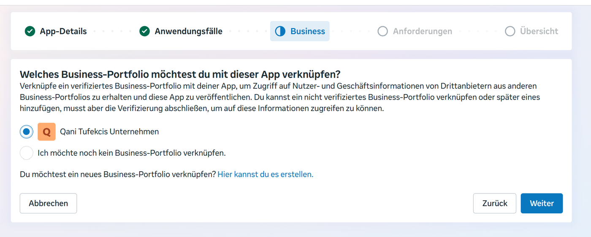

### Anforderungen

„Keine Erfordernisse erkannt" → **Weiter**.

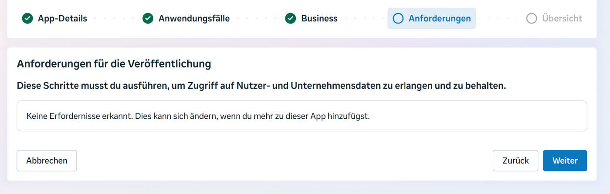

### Übersicht

Prüfen und dann **App erstellen**.

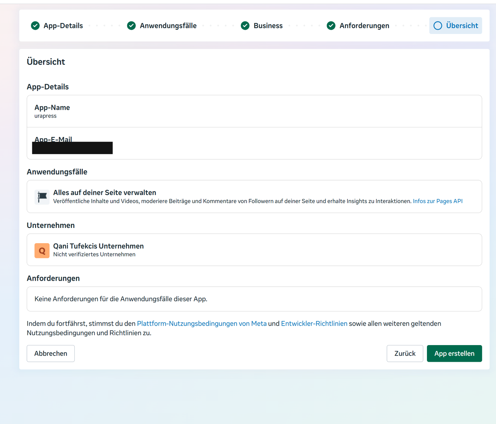

---

## Schritt 3 – Berechtigungen in der App freischalten ⚠️ wichtigster Schritt

Hier lag die meiste Zeit das Problem. Die App muss diese drei Rechte **selbst** freigeschaltet haben,
sonst lassen sie sich im Explorer nicht auswählen:

| Berechtigung | Wofür |
|---|---|
| `pages_show_list` | Liste der eigenen Seiten lesen |
| `pages_manage_posts` | Beiträge posten |
| `pages_read_engagement` | wird von Facebook für `pages_manage_posts` **zwingend** verlangt |

So geht's:
1. developers.facebook.com → **Meine Apps** → **urapress**
2. Links **Anwendungsfälle** → bei „Alles auf deiner Seite verwalten" auf **Anpassen**
3. Bei allen drei Rechten auf **+ Hinzufügen** klicken, bis überall **„Bereit zum Testen"** steht.

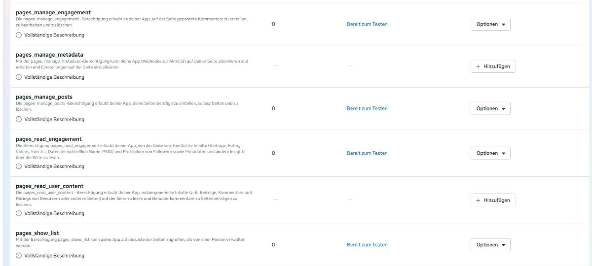

> **Verwechslungsgefahr:** `pages_manage_engagement` ≠ `pages_read_engagement`.
> Am 19.10. war versehentlich **manage**_engagement drin und **read**_engagement fehlte.
> Deshalb kam der Fehler „Invalid Scopes" (siehe unten).

---

## Schritt 4 – Nutzer-Token im Graph API Explorer

1. **developers.facebook.com/tools/explorer** öffnen
2. Rechts bei **Meta-App** die richtige App wählen (**urapress**, nicht TCM TEST).

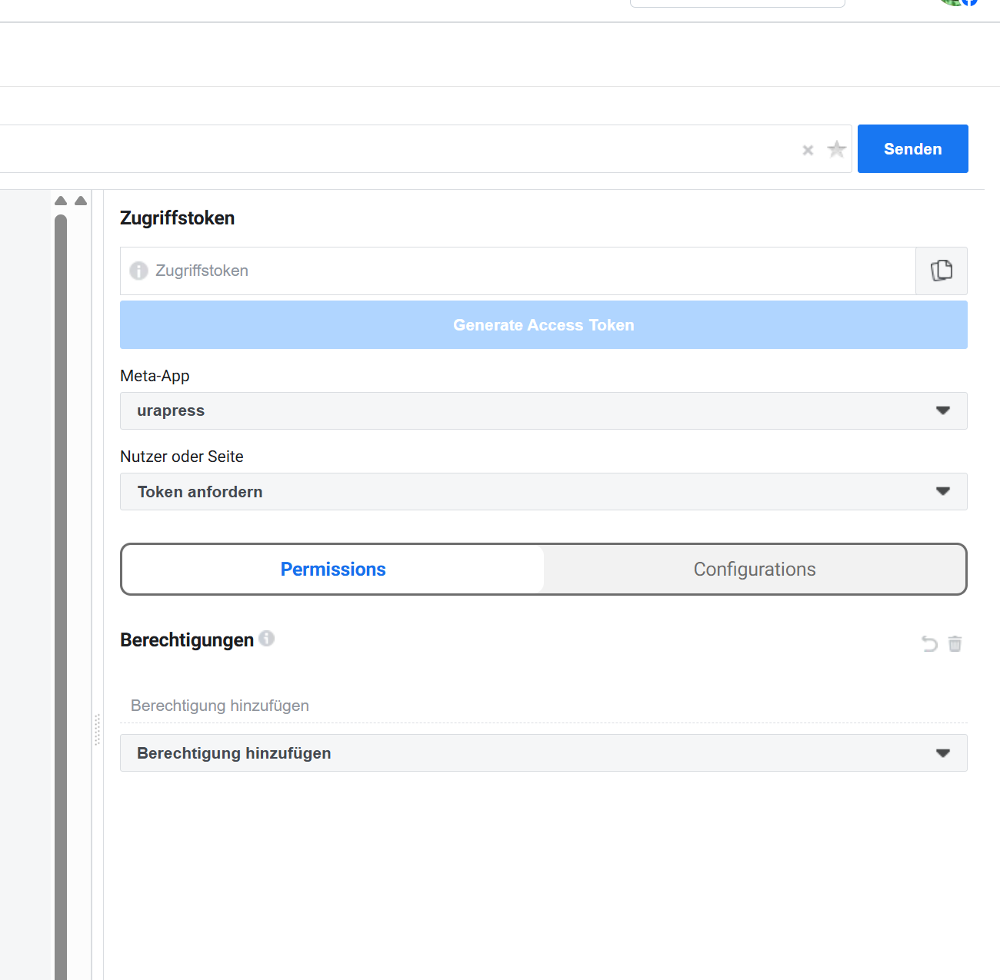

3. Unter **Berechtigungen** → „Berechtigung hinzufügen": die drei Rechte **eintippen und anklicken**:
   `pages_show_list`, `pages_manage_posts`, `pages_read_engagement`.
   `pages_manage_engagement` **nicht** dazunehmen.

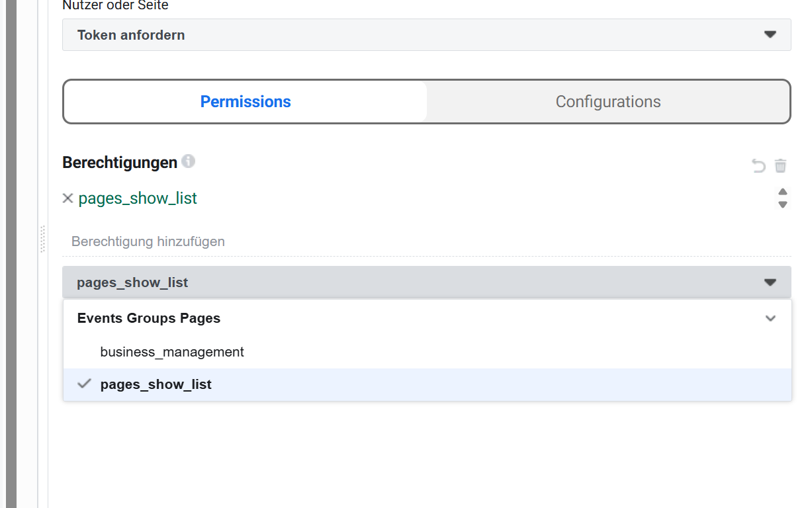

4. Auf den blauen Knopf **Generate Access Token** klicken. Im Facebook-Fenster die Seite **Urapress.ch** anhaken und erlauben.

Jetzt steht im Feld „Zugriffstoken" ein **Nutzer-Token** (gilt nur ~1 Stunde).

---

## Schritt 5 – Nutzer-Token verlängern

1. Im Feld „Zugriffstoken" auf das blaue **ⓘ** links klicken → **„Im Zugriffsschlüssel-Tool öffnen"**
2. Unten auf **„Zugriffstoken verlängern"** klicken
3. Darunter erscheint der **verlängerte Token**, gültig bis in etwa 2 Monaten. Diesen kopieren.

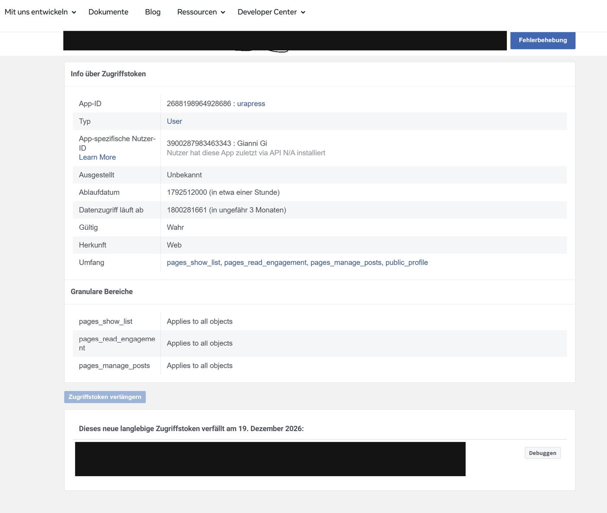

---

## Schritt 6 – Seiten-ID und Seiten-Token holen

### Seiten-ID

Im Explorer oben abfragen und auf **Senden** klicken:
```
me/accounts?fields=name,id,tasks
```
Bei der Seite steht die `id`. Das ist **`FB_PAGE_ID`**. Bei `tasks` muss **CREATE_CONTENT** stehen.

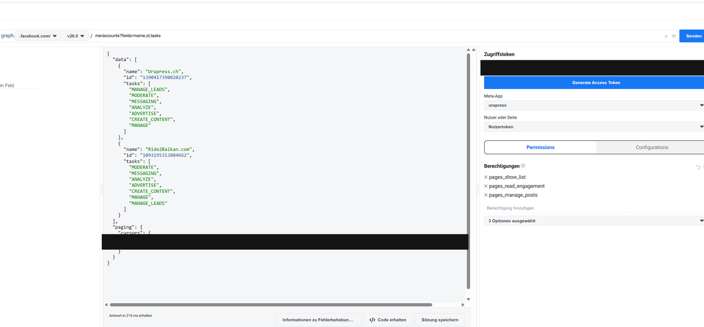

Bekannte IDs:

| Seite | ID |
|---|---|
| Urapress.ch | `1390417390820237` |
| Ride2Balkan.com | `1093195313884662` |

### Seiten-Token

1. Im Feld „Zugriffstoken" den Inhalt löschen und den **verlängerten Token** aus Schritt 5 einfügen.
2. Oben abfragen (ID der Seite einsetzen) und auf **Senden** klicken:
   ```
   1390417390820237?fields=access_token
   ```
3. Der angezeigte `"access_token": "EAA…"` ist der **Seiten-Token**. Er kommt in **`FB_PAGE_TOKEN`**.
   Weil er aus einem verlängerten Nutzer-Token kommt, **läuft er nicht ab**.

---

## Schritt 7 – Auf dem Server eintragen

```
ssh ktifeki@185.178.195.35
sudo nano /opt/urapress-bot/.env
```

Ganz nach unten gehen, Enter drücken und **diese zwei Zeilen neu hinzufügen** (sie stehen noch nicht drin!):
```
FB_PAGE_ID=1390417390820237
FB_PAGE_TOKEN=EAA...der-seiten-token...
```
Ohne Leerzeichen, ohne Anführungszeichen.

Speichern: **Ctrl+O**, **Enter**, **Ctrl+X**.

Neu starten und prüfen:
```
sudo systemctl restart urapress-bot
sudo grep -c "^FB_PAGE_TOKEN=EAA" /opt/urapress-bot/.env
sudo systemctl status urapress-bot --no-pager | head -3
```
- `grep` zeigt **1** → Token-Zeile ist da
- Status zeigt **active (running)**

`grep` braucht `sudo`, weil die `.env` nur für den Bot lesbar ist. Ohne `sudo` kommt „Permission denied".

### Test in Telegram

`/skano` schicken. Bei jedem Vorschlag erscheinen jetzt drei Knöpfe:

- **📘 Posto + FB** → Website **und** Facebook (Foto + Titel + Kurztext + Link)
- **✅ Posto** → nur Website
- **❌ Refuzo**

Der Knopf 📘 erscheint **nur**, wenn `FB_PAGE_ID` und `FB_PAGE_TOKEN` gesetzt sind.

---

## Fehler, die uns passiert sind

### „Invalid Scopes: pages_read_engagement, pages_read_user_content"

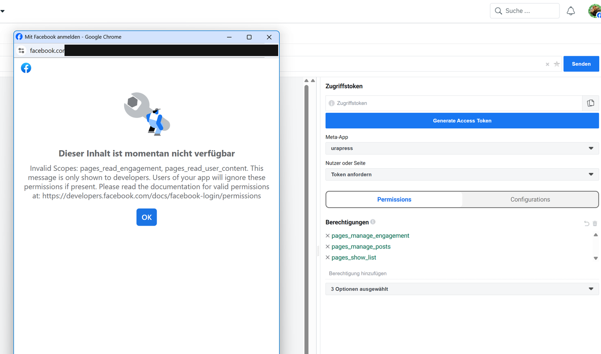

**Ursache:** Eine Berechtigung ist in der App (Schritt 3) **nicht freigeschaltet**.
`pages_read_user_content` kommt nur dazu, wenn `pages_manage_engagement` ausgewählt ist. Das brauchen wir nicht.
**Lösung:** In der App `pages_read_engagement` hinzufügen. Im Explorer `pages_manage_engagement` entfernen.

### „An active access token must be used …" (Code 2500)

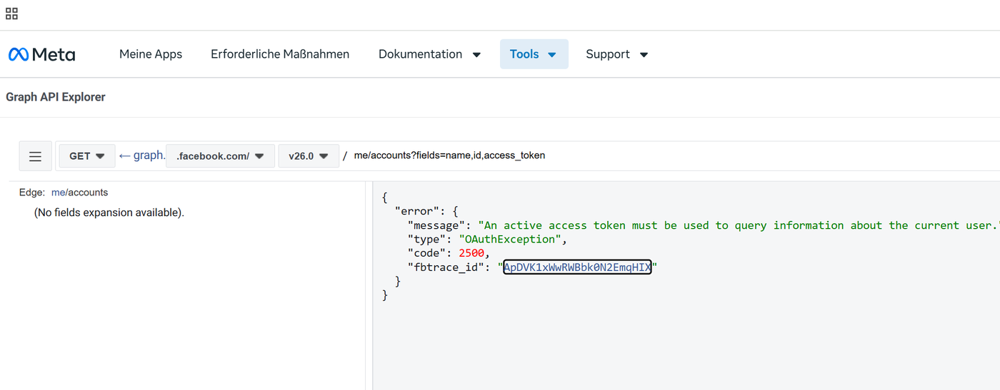

**Ursache:** Das Feld „Zugriffstoken" ist leer.
**Lösung:** Zuerst auf **Generate Access Token** klicken, dann abfragen.

### Berechtigung lässt sich im Explorer nicht auswählen

**Ursache:** Sie ist in der App nicht freigeschaltet (Schritt 3).
**Lösung:** Erst in der App **+ Hinzufügen** klicken, dann im Explorer **F5** drücken.

### Seite erscheint nicht zur Auswahl

**Ursache:** Es ist ein **Profil**, keine Seite, oder du bist kein Admin.
**Lösung:** Schritt 1.

### Falsche App gewählt

Im Explorer oben rechts **Meta-App** prüfen: **urapress**, nicht TCM TEST.

### `git` meldet „dubious ownership" auf dem Server

Der Ordner gehört dem Bot-Benutzer. Darum immer **`sudo git ...`** verwenden.

---

## Wann muss man das wiederholen?

Der Seiten-Token läuft **nicht** von selbst ab. Er wird aber **ungültig**, wenn:
- du dein **Facebook-Passwort änderst**
- du die App in den Facebook-Einstellungen **entfernst**
- du kein Admin der Seite mehr bist

Dann: Schritte 4–7 wiederholen. Schritt 1–3 bleiben gültig.

Prüfen, ob ein Token noch gilt: im Zugriffsschlüssel-Tool (developers.facebook.com/tools/debug/accesstoken)
einfügen, dort muss „Gültig: Wahr" stehen.

---

## Technisch (für Entwickler)

- `facebook.py`: Graph API v21.0. Mit Bild: `POST /{page}/photos` (url + caption).
  Ohne Bild: `POST /{page}/feed` (message + link).
- `pipeline.post_to_facebook(draft_id)`: Text = Titel + Kurztext + Link. Bild = Beitragsbild aus WordPress (`media_url`).
- `bot.py`: Callback `pfb:<id>` veröffentlicht zuerst in WordPress und dann auf FB.
  Wenn FB fehlschlägt, bleibt der Artikel auf der Website und Telegram zeigt den Fehler.
- `config.py`: `FB_PAGE_ID`, `FB_PAGE_TOKEN` (optional, leer = kein FB-Knopf).
